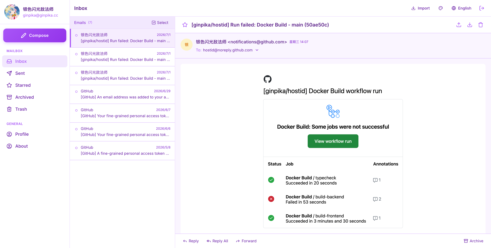
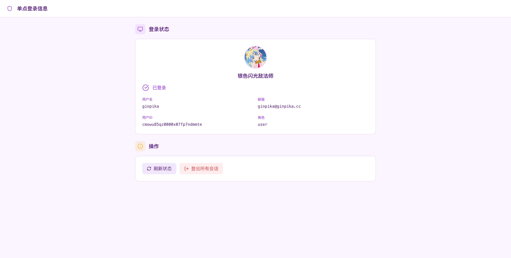
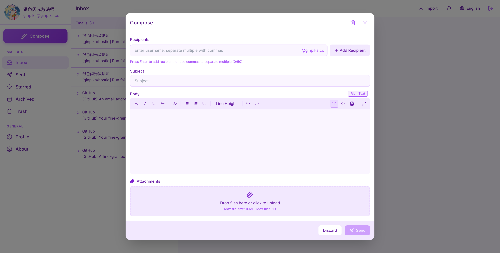

<details>
  <summary>Other previews</summary>
  
  
</details>

[中文](./README.md)

A lightweight self-hosted email application with a minimalist identity authentication service, built on nodemailer + express.js.

## Why I Built HostID

1. I wanted a self-hosted email server with better UI/UX. While there are free email services available, they tend to be either slow or full of ads.
2. I needed a simple SSO or OAuth2 authentication service to manage the various web services I've built.

HostID is the implementation of both of these needs.

## Deployment

```shell
mkdir ./hostid
cd hostid
wget https://raw.githubusercontent.com/ginpika/hostid/refs/heads/main/docs/docker-compose.yaml
docker compose up -d --wait
```

No configuration file is required. Open the site and the first-run wizard at `/setup` asks for the site URL and mail domain and creates the first administrator (password of at least 12 characters). Everything else — SMTP relay, Cloudflare Turnstile, SSO cookies, fused mail — lives in Admin → System Settings and applies immediately.

`JWT_SECRET` and `DATA_ENCRYPTION_KEY` are generated on first start and stored in `secrets.json` (mode 0600) in the data volume. **Always back up the whole data volume (database + secrets.json).** Without secrets.json, encrypted data (OAuth client secrets, fused-mail tokens, SMTP/Turnstile secrets) cannot be decrypted and all sessions are invalidated.

Use Docker Compose v2.24 or newer. Host ports are configured separately with `FRONTEND_PORT` and `BACKEND_PORT`; backend HTTP binds to `127.0.0.1` by default. SMTP still publishes host port 25, mapped to unprivileged container port 2525. Set `IMAGE_TAG=sha-<full-commit-sha>` in the Compose `.env` file to deploy a matching frontend/backend pair from a successful workflow. Turnstile is configured in the admin System Settings page; no build secret is needed. See the [Docker deployment guide](docs/docker.md) for build, upgrade, and CI details.

If you forget an admin password, run `node reset-admin.cjs <username>` inside the container; the new password is printed once to the terminal.

The optional `ghcr.io/ginpika/hostid-full` image (AMD64 / ARM64) serves the frontend, API, and SMTP in one container. Use [the full-image Compose file](docs/docker-compose.full.yaml) — no configuration file is needed either. For a source build, run `docker compose -f docker-compose.full.yaml up -d --build --wait`. The separate frontend and backend images remain available. See [Docker deployment](docs/docker.md) for details and migration instructions.

## Optional environment variables

Environment variables are only optional overrides (database path, ports, custom secrets); see ./backend/.env.example. Site, mail, SMTP, Turnstile and SSO values that older versions read from env are imported into the database once on the first start after upgrading; from then on System Settings is the source of truth.

## Development

### Prerequisites
- Node.js 20+
- Docker

#### Backend Setup

```bash
cd backend

# Install dependencies
npm install

# Generate Prisma client
npm run db:generate

# Run database migrations
npm run db:migrate

# Start the dev server
npm run dev
```

#### Frontend Setup

```bash
cd frontend

# Install dependencies
npm install

# Start the dev server
npm run dev
```

## SSO Integration

HostID can serve as an SSO provider for other applications. See the integration guides:

- [Node.js Integration](docs/sso-integration-nodejs.md)
- [Go Integration](docs/sso-integration-go.md)
- [Java Integration](docs/sso-integration-java.md)
- [Rust Integration](docs/sso-integration-rust.md)

### Quick SSO Integration

1. **Check session** from the client application:
   ```javascript
   const res = await fetch('https://mail.yourdomain.com/api/sso/session', {
     credentials: 'include'
   })
   const { authenticated, user } = await res.json()
   ```

2. **Redirect to login page** if not authenticated:
   ```javascript
   window.location.href = `https://mail.yourdomain.com/sso/login?redirect=${encodeURIComponent(currentUrl)}`
   ```

## Fused Mail

Link several Gmail / Outlook (Hotmail) mailboxes via OAuth2, sync them over IMAP and read everything in the Fused inbox. The callback URL is `https://<your-domain>/api/fused-mail/oauth/callback`. See [docs/fused-mail.md](docs/fused-mail.md) (Chinese) for Google Cloud / Azure registration and why the Google app must be published (refresh tokens of apps in "Testing" expire after 7 days).

## DNS Configuration

To ensure the mail server works properly, configure the following DNS records:

```
# MX Record
yourdomain.com.    IN    MX    10    mail.yourdomain.com.

# A Record (pointing to server IP)
mail.yourdomain.com.    IN    A    your.server.ip

# SPF Record
yourdomain.com.    IN    TXT    "v=spf1 mx -all"

# DKIM Record (if configured)
default._domainkey.yourdomain.com.    IN    TXT    "v=DKIM1; k=rsa; p=your-public-key"

# DMARC Record
_dmarc.yourdomain.com.    IN    TXT    "v=DMARC1; p=quarantine; rua=mailto:postmaster@yourdomain.com"
```
