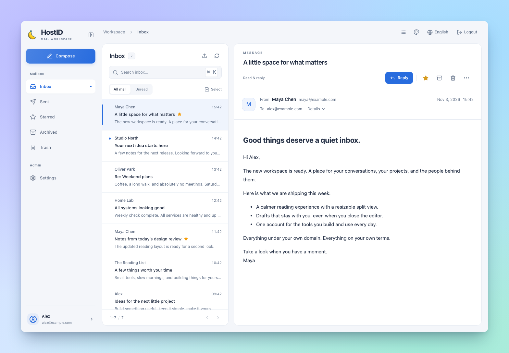
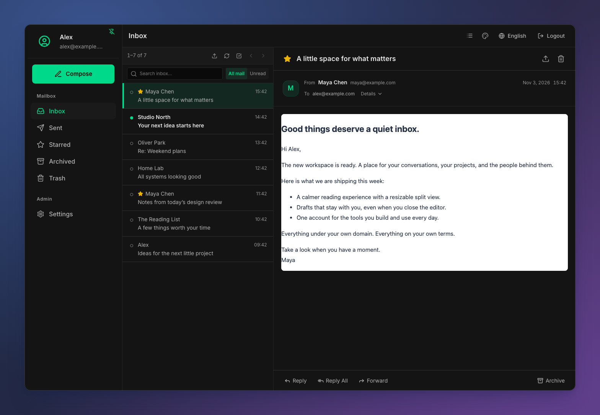
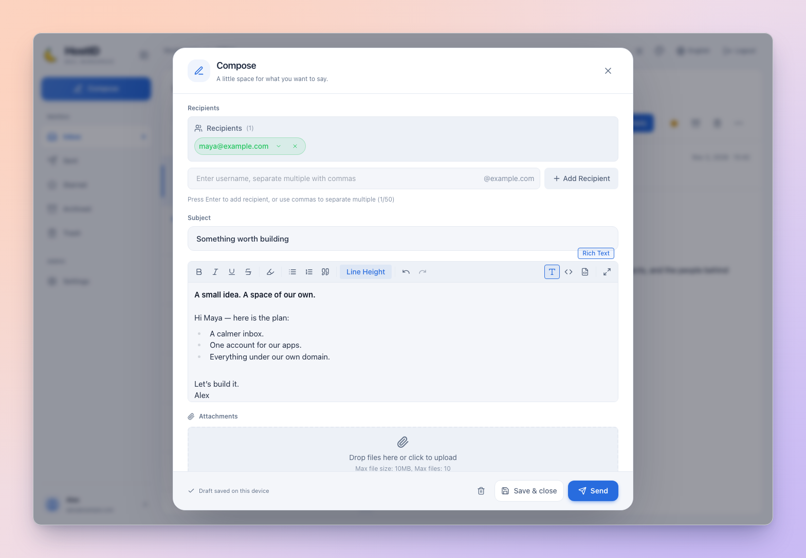

<div align="center">


# HostID

**自己的域名，自己的邮箱，自己的账号。**

一个自托管的 Web 邮箱，也是你写的那些应用的统一登录入口。

为去中心化的互联网而设计，从一个由自己运营的实例开始。

[](https://github.com/ginpika/hostid/actions/workflows/docker-build.yml)
[](./docs/zh-CN/docker.md)
[](#identity)

[English](./README.md) · **简体中文**

[看看界面](#preview) · [去中心化设计](#decentralization) · [立即部署](#quick-start) · [接入应用](#identity) · [查阅文档](./docs/zh-CN/README.md)

</div>

<a id="preview"></a>



<details>
<summary>换个心情，还是你的邮箱。</summary>

**经典界面，也有深色。**



**认真写一封信。**



</details>

## 让你的域名，多做一点事

你有域名，有服务器，还有越写越多的小项目。HostID 想把它们串起来：`you@yourdomain.com` 用来收信，同一个账号用来登录自己的服务。

最初的需求很私人：想要一个用起来舒服的自托管邮箱，再给自己写的应用找一个简单的统一登录入口。于是，就有了 HostID。

<a id="decentralization"></a>

## 去中心化的互联网，也有属于你的一角

HostID 的去中心化设计，从可以独立部署、自主运营的实例开始。在自己的域名下运行邮箱和身份服务，创建账号与登录都无需依赖 HostID 官方运营的账号中心。

- **域名在手，地址由自己定义。** 让邮箱地址和登录入口落在自己掌握的域名下。
- **数据落在自己的部署里。** 邮件、账号、附件和实例密钥由自己的实例保存，存储与备份策略由运营者决定。
- **自己的应用，认自己的账号。** 创建本地账号，通过 SSO 或 OAuth 2.0 为自己的项目提供统一登录。
- **用开放协议连接外界。** 通过 SMTP 交换邮件，通过 OAuth 2.0 接入应用，自主选择中继和第三方登录服务商。

这里的去中心化，指独立部署与运营自主权：每个实例管理自己的账号与认证。个人服务器也好，社区共同运营的实例也好，都可以在互联网上拥有自己的入口。

## 一个让人愿意每天打开的邮箱

| 你的日常 | HostID 准备了什么 |
| --- | --- |
| **读得舒服** | 分栏阅读、列表视图、可拖动调整的阅读面板；HTML 邮件在隔离框架内保留原有排版。 |
| **找得到重点** | 当前文件夹搜索、未读筛选、星标、归档和批量操作。 |
| **写得认真** | 富文本、Markdown、HTML 编辑；回复、回复全部、转发、抄送、密送和附件。 |
| **下次接着写** | 草稿自动保存在当前设备，支持恢复附件。 |
| **看着像自己** | 10 种主题，包含经典浅色与深色；支持跟随系统、中英文切换。 |
| **配置不费劲** | 首次启动向导，以及集中管理系统设置、用户、OAuth 服务商和客户端应用的后台。 |

内置 SMTP 收信，通过 SMTP 中继或直接连接收件域 MX 发信。支持 `.eml` 导入与导出；导出文件包含邮件头和正文，不包含附件。

<a id="quick-start"></a>

## 把邮箱搬到自己的服务器上

准备好 **Docker 和 Compose 2.24+**。全量单镜像包含前端、API 和 SMTP 服务，支持 **AMD64 / ARM64**。

```sh
mkdir hostid
cd hostid
curl -fsSL https://raw.githubusercontent.com/ginpika/hostid/refs/heads/main/docs/docker-compose.full.yaml -o docker-compose.full.yaml
docker compose -f docker-compose.full.yaml up -d --wait
```

打开 **[http://localhost:3000](http://localhost:3000)**；远程部署时，把 `localhost` 换成服务器地址。首次访问会进入 `/setup`：

1. 填写站点对外地址和邮件域名。
2. 创建第一个管理员，密码至少 12 位。
3. 按需前往「设置 → 系统设置」配置 SMTP 中继、Turnstile 和 SSO。

不用预先准备环境文件，也不用翻日志找默认管理员密码。大多数设置保存后立即生效。

默认宿主机端口为 **HTTP `3000`**、**入站 SMTP `25`**。需要修改时，在 Compose 同目录的 `.env` 中设置 `FRONTEND_PORT` 或 `SMTP_PORT`。公开部署时，为 HTTP 配置 HTTPS 反向代理，并在初始化时填写对应的公网地址。

想把前后端分开部署，或从源码构建？参阅 [Docker 部署文档](./docs/zh-CN/docker.md) 和 [双容器 Compose](./docs/docker-compose.yaml)。

### 让域名真正开始收发邮件

启动应用后就能使用 Web 界面。要接收来自互联网的邮件，还需要配置 DNS 并开放 SMTP 端口：

| 记录 | 示例 |
| --- | --- |
| `example.com` 的 `MX` | 优先级 `10`，指向 `mail.example.com` |
| `mail.example.com` 的 `A` / `AAAA` | 邮件服务器的公网 IP 地址 |

确保公网 **TCP 25** 可达；HTTP 反向代理不会转发 SMTP。收件地址需要对应已存在的 HostID 用户。

对外发信建议先配置 **SMTP 中继**，再根据实际发信路径和服务商要求设置 SPF、DKIM、DMARC。直接投递到对方 MX 时，效果取决于出站 25 端口、服务器 IP 信誉及收件方策略。配置步骤和投递排查见[邮件与 DNS](./docs/zh-CN/mail.md)。

<a id="identity"></a>

## 给自己写的应用，一个共同的登录入口

邮箱账号，也可以是你其他应用认识的那个账号。

| 接入方式 | 可以做什么 |
| --- | --- |
| **共享会话 SSO** | 让同一主域下的应用检查 HostID 登录状态，并跳转到统一登录页。 |
| **作为 OAuth 2.0 服务端** | 注册客户端应用，使用授权码、PKCE S256、刷新令牌及 userinfo 接口。 |
| **第三方 OAuth 登录** | 使用已配置的服务商登录 HostID，可自定义授权、令牌和用户信息端点。 |

使用共享会话 SSO 前，先在「设置 → 系统设置」中配置 Cookie 域和允许的跨域来源。然后，应用就可以检查浏览器会话：

```js
const response = await fetch('https://mail.example.com/api/sso/session', {
  credentials: 'include',
})
const session = await response.json()

if (!session.authenticated) {
  const redirect = encodeURIComponent(window.location.href)
  window.location.assign(`https://mail.example.com/sso/login?redirect=${redirect}`)
}
```

生产环境应使用 HTTPS 和安全 Cookie。上面的会话检查用于浏览器跳转；应用后端仍需验证身份，才能返回受保护的数据。

OAuth 客户端可在管理后台创建应用并登记回调地址。全量单镜像通过 `/.well-known/oauth-authorization-server` 提供授权服务器元数据；前后端分离部署时，需要将该路径转发到后端。当前实现 OAuth 2.0，不签发 OpenID Connect ID Token。

客户端应用从 [OAuth 2.0 指南](./docs/zh-CN/oauth.md)开始，同一主域下的可信服务可使用[共享会话 SSO](./docs/zh-CN/sso.md)。服务端 SSO 示例：[Node.js](./docs/zh-CN/sso-integration-nodejs.md) · [Go](./docs/zh-CN/sso-integration-go.md) · [Java](./docs/zh-CN/sso-integration-java.md) · [Rust](./docs/zh-CN/sso-integration-rust.md)。

## 搭好之后，也要好照顾

**备份数据，也备份打开数据的钥匙。** `backend_data` 卷包含 SQLite 数据库和自动生成的 `secrets.json`，两者必须**一起备份、一起恢复**。密钥丢失后，加密设置将无法解密，已有会话也会失效。完整备份还应包含 `backend_uploads`、`backend_avatars` 和 `backend_logs`，并保留 Compose 和环境文件。如果显式设置了 `JWT_SECRET` 或 `DATA_ENCRYPTION_KEY`，还需安全备份实际使用的密钥值。

升级前先备份，然后在部署目录执行：

```sh
docker compose -f docker-compose.full.yaml pull
docker compose -f docker-compose.full.yaml up -d --wait
```

保留原有 Compose 项目名和卷名。**不要用 `docker compose down -v` 升级**，它会删除数据卷。需要固定到已发布的提交版本时，在 Compose `.env` 中设置 `IMAGE_TAG=sha-<完整提交 SHA>`。

<details>
<summary>忘记管理员密码了？</summary>

将 `your_username` 替换为管理员用户名：

```sh
docker compose -f docker-compose.full.yaml exec hostid-full node reset-admin.cjs your_username
```

新密码只在终端输出一次。

</details>

<details>
<summary>可以连接桌面邮件客户端吗？</summary>

HostID 当前提供 Web 邮箱和 SMTP 收信服务，不提供 IMAP / POP3。入站 SMTP 暂不提供 STARTTLS，也没有内置 DKIM 签名；部署需要这些能力时，应配合合适的邮件网关或中继服务。

</details>

## 继续折腾，也很方便

前端使用 **React + TypeScript + Vite**，后端使用 **Express + Prisma + SQLite**。Nodemailer 负责发信，`smtp-server` 负责收信，Tiptap 负责写信。

<details>
<summary>从源码运行与本地开发</summary>

使用 **Node.js 22+**。完整本地配置与检查说明见[开发指南](./docs/zh-CN/development.md)。在源码目录中，先启动后端：

```sh
cd backend
npm ci
npm run db:generate
export DATABASE_URL="file:./dev.db"
npm run db:migrate
npm run dev
```

另开终端，在仓库根目录启动前端：

```sh
npm ci --workspace=frontend
npm run dev
```

打开 `http://localhost:3000` 完成初始化。API 端口为 `3001`，本地 SMTP 默认端口为 `2525`。上述数据库地址用于本地开发；其他基础设施覆盖项见 [`backend/.env.example`](./backend/.env.example)。

在仓库根目录执行检查：

```sh
npm test
npm run typecheck
npm --prefix backend run typecheck
```

</details>

<a id="documentation"></a>

## 文档

[打开文档首页](./docs/zh-CN/README.md)，按部署、接入与开发任务查找指南。每篇都有对应的 English / 简体中文入口。

| 你想做的事 | 对应文档 |
| --- | --- |
| 部署、升级或恢复实例 | [Docker 部署](./docs/zh-CN/docker.md) |
| 配置运行中的实例 | [系统设置](./docs/zh-CN/configuration.md) |
| 接入邮件域名与排查投递 | [邮件与 DNS](./docs/zh-CN/mail.md) |
| 接入应用或外部登录服务商 | [OAuth 2.0](./docs/zh-CN/oauth.md) · [共享会话 SSO](./docs/zh-CN/sso.md) |
| 运行源码与执行检查 | [本地开发](./docs/zh-CN/development.md) |
| 了解邮件正文如何显示 | [邮件渲染](./docs/zh-CN/email-rendering.md) |
| 修改界面与设计 | [设计系统](./docs/zh-CN/design-system.md) |
| 与嵌入宿主同步外观 | [外观同步](./docs/zh-CN/embedding.md) |

<div align="center">

**给邮件一个家，也给自己的应用一个熟悉的入口。**

</div>
