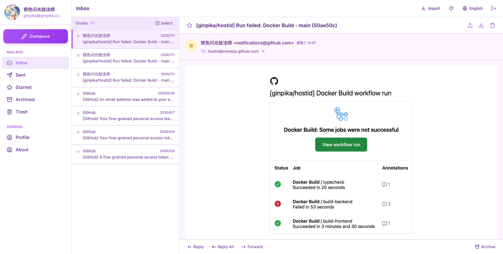
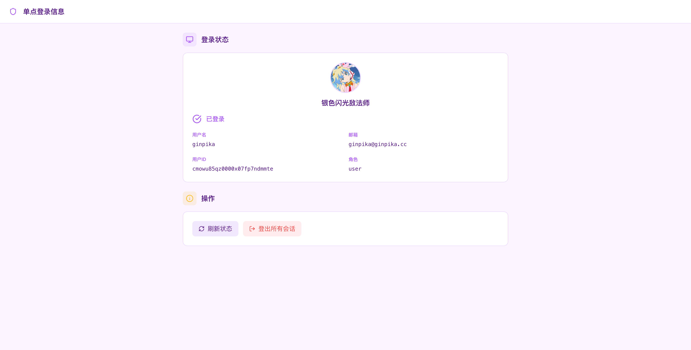
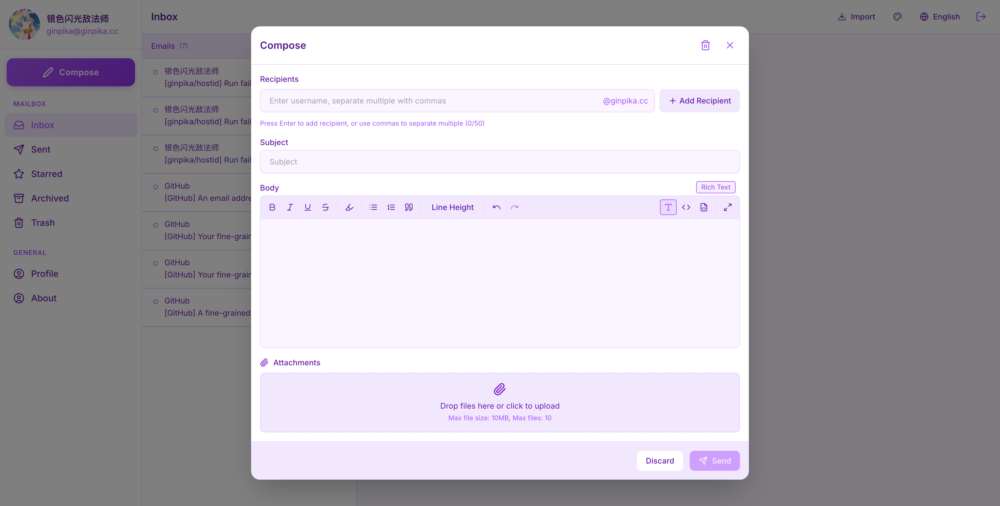

<details>
  <summary>Others preview</summary>
  
  
</details>

[English](./README-en.md)

一个轻量级的自托管邮件应用，提供极简的身份认证服务，基于 nodemailer + express.js。

## 我为什么写了 hostid

1. 我想要一个 UI/UX 更出色自托管的邮件服务器，市面上的邮件服务虽然免费，要么很卡，要么有广告
2. 我需要一个简单的 sso or oauth2 的认证服务来管理我自己写的各种 web 服务

Hostid 正是上述两个需求的实现。

## 部署

```shell
mkdir ./hostid
cd hostid
wget https://raw.githubusercontent.com/ginpika/hostid/refs/heads/main/docs/docker-compose.yaml
docker compose up -d --wait
```

无需任何配置文件。启动后打开站点，首次访问会进入 `/setup` 初始化向导：填写站点地址、邮件域名，并创建第一个管理员（密码至少 12 位）。其余配置（SMTP 中继、Cloudflare Turnstile、SSO Cookie、融合邮件等）在「管理 → 系统设置」中修改，保存后立即生效。

`JWT_SECRET` 和 `DATA_ENCRYPTION_KEY` 会在首次启动时自动生成，保存在数据卷的 `secrets.json`（权限 0600）。**备份时务必同时备份整个数据卷（数据库 + secrets.json）**，丢失 secrets.json 会导致已加密数据（OAuth 密钥、融合邮件令牌、SMTP/Turnstile 密钥）无法解密、所有会话失效。

构建、端口配置、升级和 CI 发布说明见 [Docker 部署文档](docs/docker.md)。宿主机端口分别使用 `FRONTEND_PORT` 和 `BACKEND_PORT`，后端 HTTP 默认绑定 `127.0.0.1`；SMTP 对外仍为 25，容器内为 2525。推荐通过 `IMAGE_TAG=sha-<完整提交 SHA>` 固定前后端的一套版本。

另提供全量单镜像 `ghcr.io/ginpika/hostid-full`（AMD64 / ARM64），在一个容器中运行前端、API 和 SMTP。使用 [单容器 Compose](docs/docker-compose.full.yaml) 即可，同样无需配置文件。源码构建使用 `docker compose -f docker-compose.full.yaml up -d --build --wait`。现有前后端独立镜像继续提供；部署与切换方式见 [全量单镜像说明](docs/docker.md#全量单镜像-hostid-full)。

忘记管理员密码时，可在容器内执行 `node reset-admin.cjs <用户名>` 重置，新密码只在终端输出一次。

## 可选的环境变量

环境变量只用于可选覆盖（数据库路径、端口、自定义密钥等），详见 ./backend/.env.example。旧版本通过环境变量配置的站点、邮件、SMTP、Turnstile、SSO 等参数会在升级后首次启动时自动导入数据库，之后以「系统设置」为准。

## 开发

### 前置条件
- Node.js 20+
- Docker

#### 后端设置

```bash
cd backend

# 安装依赖
npm install

# 生成 Prisma 客户端
npm run db:generate

# 运行数据库迁移
npm run db:migrate

# 启动开发服务器
npm run dev
```

#### 前端设置

```bash
cd frontend

# 安装依赖
npm install

# 启动开发服务器
npm run dev
```

## SSO 集成

HostID 可以作为其他应用的 SSO 提供商。请参阅集成指南：

- [Node.js 集成](docs/sso-integration-nodejs.md)
- [Go 集成](docs/sso-integration-go.md)
- [Java 集成](docs/sso-integration-java.md)
- [Rust 集成](docs/sso-integration-rust.md)

### 快速 SSO 集成

1. **检查会话** 从客户端应用：
   ```javascript
   const res = await fetch('https://mail.yourdomain.com/api/sso/session', {
     credentials: 'include'
   })
   const { authenticated, user } = await res.json()
   ```

2. **重定向到登录页** 如果未认证：
   ```javascript
   window.location.href = `https://mail.yourdomain.com/sso/login?redirect=${encodeURIComponent(currentUrl)}`
   ```

## 融合邮件

通过 OAuth2 关联多个 Gmail / Outlook（Hotmail）邮箱，用 IMAP 增量收信，在「融合收件箱」统一查看。回调地址为 `https://<你的域名>/api/fused-mail/oauth/callback`。Google Cloud / Azure 注册步骤、发布 Google 应用（测试状态下 refresh token 7 天过期）等说明见 [docs/fused-mail.md](docs/fused-mail.md)。

## DNS 配置

为确保邮件服务器正常工作，请配置以下 DNS 记录：

```
# MX 记录
yourdomain.com.    IN    MX    10    mail.yourdomain.com.

# A 记录 (指向服务器 IP)
mail.yourdomain.com.    IN    A    your.server.ip

# SPF 记录
yourdomain.com.    IN    TXT    "v=spf1 mx -all"

# DKIM 记录 (如已配置)
default._domainkey.yourdomain.com.    IN    TXT    "v=DKIM1; k=rsa; p=your-public-key"

# DMARC 记录
_dmarc.yourdomain.com.    IN    TXT    "v=DMARC1; p=quarantine; rua=mailto:postmaster@yourdomain.com"
```
