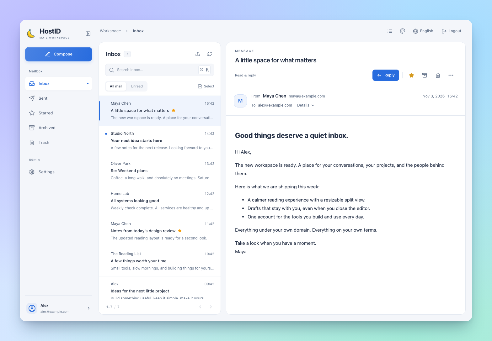
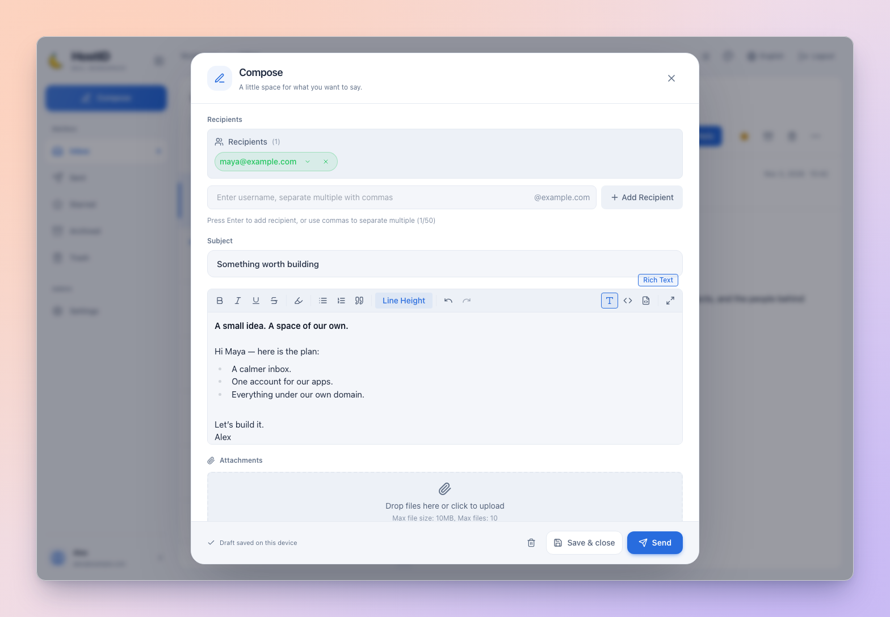

<div align="center">


# HostID

**Self-hosted webmail and sign-in for your own domain.**

A self-hosted web mail client that also provides SSO and OAuth 2.0 for your apps.

[](https://github.com/ginpika/hostid/actions/workflows/docker-build.yml)
[](./docs/docker.md)
[](#identity)

**English** · [简体中文](./README-zh-CN.md)

[Screenshots](#preview) · [Architecture](#decentralization) · [Quick start](#quick-start) · [Identity](#identity) · [Documentation](./docs/README.md)

</div>

<a id="preview"></a>



<details>
<summary>More screenshots.</summary>

**Compose.**



</details>

## What HostID is for

HostID is for people who own a domain and run their own server. It started from two needs: a self-hosted mailbox I wanted to use daily, and a simple way for my own services to sign in. It provides both: mail at `you@yourdomain.com`, and one account your apps can authenticate against.

<a id="decentralization"></a>

## Independent instances and local accounts

HostID does not depend on a HostID-operated account service. Each instance runs under your domain and is responsible for its own accounts and sign-in.

- **Addresses under your domain.** Mail addresses and sign-in endpoints live in a domain you control.
- **Data in your deployment.** Mail, accounts, attachments and instance keys stay in your deployment; storage and backups are up to you.
- **Local accounts.** Create accounts in the instance and connect apps through SSO or OAuth 2.0.
- **Standard protocols.** SMTP for mail and OAuth 2.0 for apps; choose your own relay and login providers.

"Decentralized" here means independent deployment and operator control: each instance is authoritative for its own accounts. A personal server and a community instance use the same model.

## Mailbox features

| Area | Details |
| --- | --- |
| **Reading** | Split-pane or list view, a resizable reading pane, and HTML email that keeps its original layout in an isolated frame. |
| **Search and filtering** | Search the current folder, filter unread mail, star what matters, archive the rest, and handle messages in batches. |
| **Composing** | Rich text, Markdown and HTML editing; replies, reply-all, forwarding, CC/BCC, and attachments. |
| **Drafts** | Drafts are saved on the current device, with attachment recovery. |
| **Themes and language** | Ten themes, including light, dark, classic and classic-dark, plus system appearance and English / Simplified Chinese. |
| **Setup and admin** | A first-run setup wizard and an admin interface for system settings, users, OAuth providers and client apps. |

Inbound mail is handled by the built-in SMTP receiver. Outbound mail goes through a configured SMTP relay or directly to the recipient domain's MX server. You can also import and export `.eml` messages; exported files contain headers and body, without attachments.

<a id="quick-start"></a>

## Quick start

You need **Docker with Compose 2.24+**. The all-in-one image includes the web app, API and SMTP receiver, with builds for **AMD64 and ARM64**.

```sh
mkdir hostid
cd hostid
curl -fsSL https://raw.githubusercontent.com/ginpika/hostid/refs/heads/main/docs/docker-compose.full.yaml -o docker-compose.full.yaml
docker compose -f docker-compose.full.yaml up -d --wait
```

Open **[http://localhost:3000](http://localhost:3000)**, or replace `localhost` with your server address. The first visit opens `/setup`:

1. Set your public site URL and mail domain.
2. Create the first administrator, with a password of at least 12 characters.
3. Open **Settings → System Settings** to configure your SMTP relay, Turnstile and SSO settings as needed.

There is no environment file to prepare and no default administrator password; most settings take effect when you save them.

The default host ports are **3000 for HTTP** and **25 for incoming SMTP**. Set `FRONTEND_PORT` or `SMTP_PORT` in a Compose `.env` file to change them. For public access, put HTTP behind an HTTPS reverse proxy and use that public URL in setup.

Prefer separate frontend and backend containers, or a source build? See the [Docker deployment guide](./docs/docker.md) and [two-container Compose file](./docs/docker-compose.yaml).

### DNS and inbound mail

The web interface works as soon as the app starts. Receiving mail from the internet also requires DNS records and a reachable SMTP port:

| Record | Example |
| --- | --- |
| `MX` for `example.com` | Priority `10`, target `mail.example.com` |
| `A` / `AAAA` for `mail.example.com` | Your mail server's public IP address |

Allow inbound **TCP 25** to the server; an HTTP reverse proxy does not forward SMTP. Incoming recipients must be existing HostID users.

For outbound mail, start with a configured **SMTP relay**. Set SPF, DKIM and DMARC according to your actual sending path and relay provider. Direct MX delivery depends on outbound port 25, your IP's reputation and the recipient's policies. See [Mail and DNS](./docs/mail.md) for setup and delivery diagnostics.

<a id="identity"></a>

## SSO and OAuth 2.0

The mailbox account can also sign users in to your own applications.

| Connection | Use it for |
| --- | --- |
| **Shared-session SSO** | Let apps under your domain check an existing HostID session and send users to a shared login page. |
| **HostID as an OAuth 2.0 provider** | Register client apps and use authorization codes, PKCE with S256, refresh tokens and the userinfo endpoint. |
| **Third-party OAuth login** | Sign in to HostID through configured providers, with editable authorization, token and userinfo endpoints. |

For shared-session SSO, configure the cookie domain and allowed origins in **Settings → System Settings** first. Then an app can check the browser's session:

```js
const response = await fetch('https://mail.example.com/api/sso/session', {
  credentials: 'include',
})
const session = await response.json()

if (!session.authenticated) {
  const redirect = encodeURIComponent(window.location.href)
  window.location.assign(`https://mail.example.com/sso/login?redirect=${redirect}`)
}
```

Production SSO should use HTTPS and secure cookies. The session check above is for browser navigation; your app's backend still needs to validate authentication before serving protected data.

For OAuth clients, create an app in the admin interface and register its callback URLs. The all-in-one deployment serves authorization-server metadata at `/.well-known/oauth-authorization-server`; with separate containers, forward this path to the backend. HostID implements OAuth 2.0; it does not currently issue OpenID Connect ID tokens.

Start with the [OAuth 2.0 guide](./docs/oauth.md) for client apps, or [shared-session SSO](./docs/sso.md) for trusted services under the same parent domain. Server-side SSO examples: [Node.js](./docs/sso-integration-nodejs.md) · [Go](./docs/sso-integration-go.md) · [Java](./docs/sso-integration-java.md) · [Rust](./docs/sso-integration-rust.md).

## Backups and upgrades

**Back up the database together with `secrets.json`.** The `backend_data` volume holds the SQLite database and automatically generated `secrets.json`. Back them up and restore them **together**: losing the keys prevents encrypted settings from being read and invalidates existing sessions. Include `backend_uploads`, `backend_avatars` and `backend_logs`, and preserve your Compose and environment files. If you explicitly supply `JWT_SECRET` or `DATA_ENCRYPTION_KEY`, securely back up those exact values too.

To update, back up first, then run in your deployment directory:

```sh
docker compose -f docker-compose.full.yaml pull
docker compose -f docker-compose.full.yaml up -d --wait
```

Keep the same Compose project and volume names. **Do not use `docker compose down -v` to upgrade** — it deletes the data volumes. To pin a release to a published commit, set `IMAGE_TAG=sha-<full-commit-sha>` in the Compose `.env` file.

<details>
<summary>Forgot the administrator password?</summary>

Replace `your_username` with the administrator's username:

```sh
docker compose -f docker-compose.full.yaml exec hostid-full node reset-admin.cjs your_username
```

The new password is printed once in the terminal.

</details>

<details>
<summary>Can I connect a desktop mail client?</summary>

HostID currently provides a web mailbox and an SMTP receiver. It does not provide IMAP or POP3 access. The inbound SMTP receiver currently does not offer STARTTLS, and DKIM signing is not built in; use a suitable mail gateway or relay when your deployment needs those capabilities.

</details>

## Tech stack

**React + TypeScript + Vite** on the frontend. **Express + Prisma + SQLite** on the backend. Nodemailer for outbound mail, `smtp-server` for inbound, and Tiptap for the editor.

<details>
<summary>Run from source and develop locally</summary>

Use **Node.js 22+**. The [development guide](./docs/development.md) covers local configuration and checks. From a checkout, start the backend in one terminal:

```sh
cd backend
npm ci
npm run db:generate
export DATABASE_URL="file:./dev.db"
npm run db:migrate
npm run dev
```

In a second terminal, from the repository root:

```sh
npm ci --workspace=frontend
npm run dev
```

Open `http://localhost:3000` and complete setup. The API runs on `3001`; local SMTP defaults to `2525`. The database URL above selects a local development database. Optional infrastructure overrides are documented in [`backend/.env.example`](./backend/.env.example).

Run checks from the repository root:

```sh
npm test
npm run typecheck
npm --prefix backend run typecheck
```

</details>

<a id="documentation"></a>

## Documentation

[Open the documentation index](./docs/README.md) for setup paths, integration choices and developer references. Every guide is available in English and Simplified Chinese.

| What you're doing | Where to go |
| --- | --- |
| Deploying, upgrading or recovering an instance | [Docker guide](./docs/docker.md) |
| Configuring the running instance | [System settings](./docs/configuration.md) |
| Connecting a mail domain and diagnosing delivery | [Mail and DNS](./docs/mail.md) |
| Connecting an app or an external login provider | [OAuth 2.0](./docs/oauth.md) · [Shared-session SSO](./docs/sso.md) |
| Running and checking the source | [Local development](./docs/development.md) |
| Understanding how email content is displayed | [Email rendering](./docs/email-rendering.md) |
| Working on the interface | [Design system](./docs/design-system.md) |
| Syncing appearance with an embedding host | [Appearance integration](./docs/embedding.md) |
